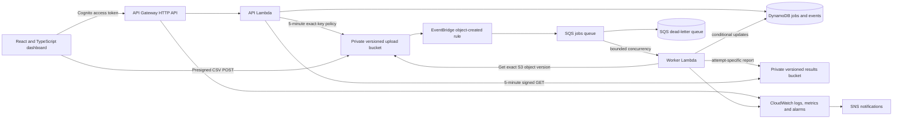
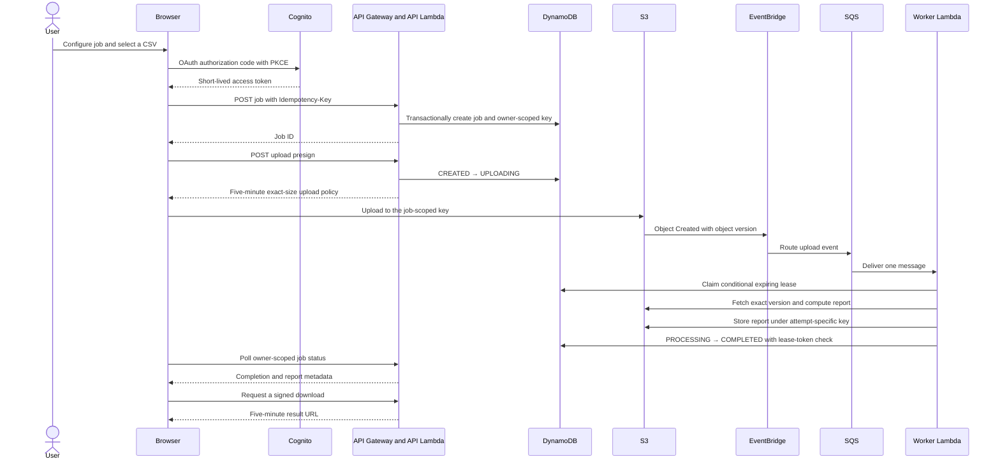
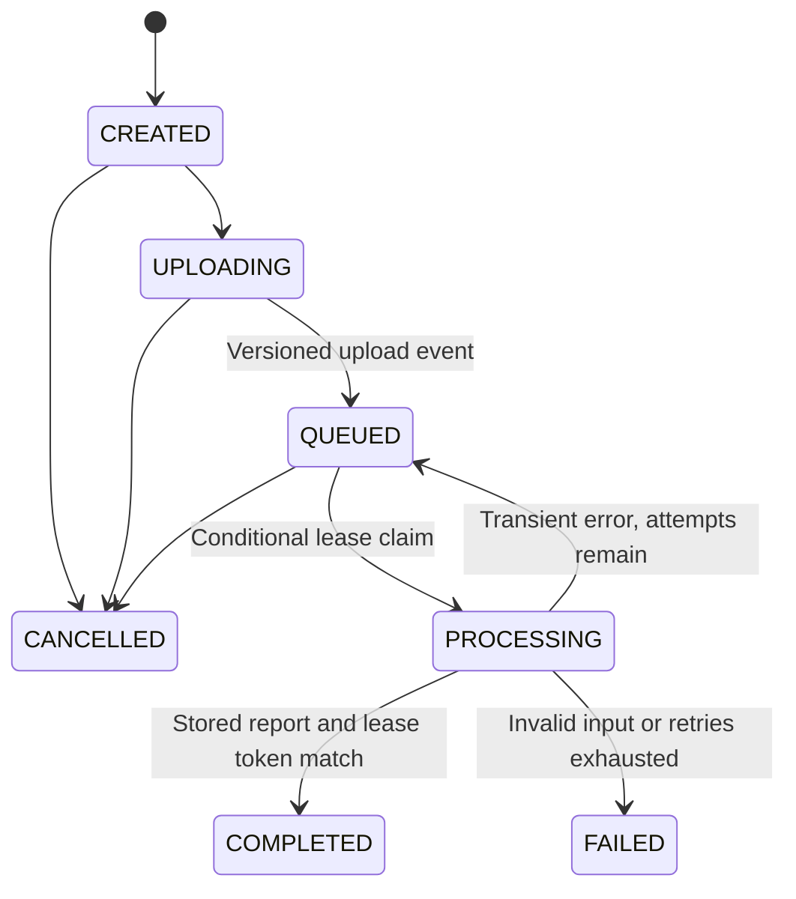
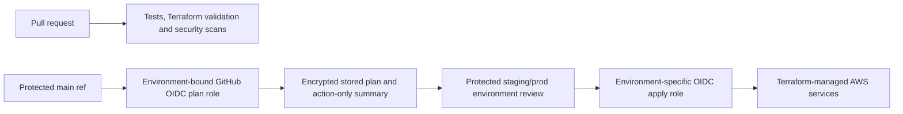

# Architecture

CloudForge accepts bounded CSV files, validates rows in a separate worker, and stores compact job records independently of source files and reports. The browser authenticates with Amazon Cognito and calls an Amazon API Gateway HTTP API. A direct upload writes to a private, versioned S3 bucket; EventBridge sends the matching upload notification through an SQS queue before invoking the worker Lambda. The worker writes a version-scoped JSON report and conditionally completes the DynamoDB job.

## Job states

Worker claims get a random token and a 120-second expiration. A duplicate event cannot steal an unexpired lease. A result is stored under an attempt-specific key before the job's conditional update; only the worker holding the lease can complete the job. Invalid files fail once with a stable error code. Transient service errors release the job for the next SQS delivery. SQS retries messages up to five receives before the dead-letter queue. A transiently exhausted job is `FAILED` while its message is retained for diagnosis.

The queue's visibility timeout is 360 seconds for a 60-second worker timeout. The event source processes one record at a time and reports partial batch failures. Cancellation is allowed before a worker takes ownership. A running Lambda cannot be interrupted safely, so running jobs reject cancellation.

## DynamoDB design

CloudForge uses one on-demand table. `pk=JOB#{uuid}, sk=META` stores the owner, validated request, current state, report pointer, and retry count. `gsi1pk=OWNER#{sub}` and chronological `gsi1sk={created_at}#{uuid}` support recent owner-scoped job listings. `gsi2pk=OWNER#{sub}#STATUS#{state}` and the same time-ordered sort key support state-filtered queries. Event rows use `sk=EVENT#{timestamp}#{random_id}`. Attempt rows use `sk=ATTEMPT#{attempt_number}`. Upload and output metadata use `UPLOAD` and `OUTPUT` keys. Hashed owner-scoped idempotency records expire after 24 hours; old event rows expire after 90 days. DynamoDB TTL cleanup is asynchronous.

| Request | Access pattern |
|---|---|
| Get a job | Consistent base-table read by job ID and `META`; verify `owner` equals the Cognito `sub`. |
| List recent jobs | `by-owner` query on `OWNER#{sub}`, newest first; opaque base64 continuation key. |
| Filter jobs by state | `by-status` query on `OWNER#{sub}#STATUS#{state}`, newest first. |
| Read history | Consistent base-table query on `JOB#{id}` with `begins_with(EVENT#)`. |
| Enforce idempotency | Transactionally create the job and hashed owner/key record with `attribute_not_exists(pk)`. |
| Claim a worker | Conditional update from `QUEUED` or an expired `PROCESSING` lease. |
| Transition or cancel | Conditional update on observed state; worker finalization also checks its lease token. |

Queries, point reads, and transactional writes back the common request path; the API does not use DynamoDB scans. The defined TTL is used for idempotency and event rows, not owner job or attempt records.

## CI/CD and environments

Each environment root has a separate Terraform state key, resource prefix, log retention, lifecycle period, and concurrency limit. Dev intentionally disables DynamoDB point-in-time recovery by default and uses short retention; staging and prod enable data protection. S3 and account-scoped resources include region/account components in their names. The prod configuration is a reference starting point, not a live deployment or a measured service-level commitment.

## Deliberately scoped functionality

Uploaded-file processing, durable job state, event history, and downloadable result JSON work in the local simulator. CloudWatch dashboards and alarms report AWS-native API, Lambda, SQS, DynamoDB, and custom outcome metrics after deployment. The optional application frontend is built locally and connects to the authenticated API. Serving its production files is configured through a separately operated HTTPS host to avoid adding baseline edge services. Full cross-region recovery, VPC isolation, canary deployment, distributed tracing, and production-scale load evidence are not provided.
