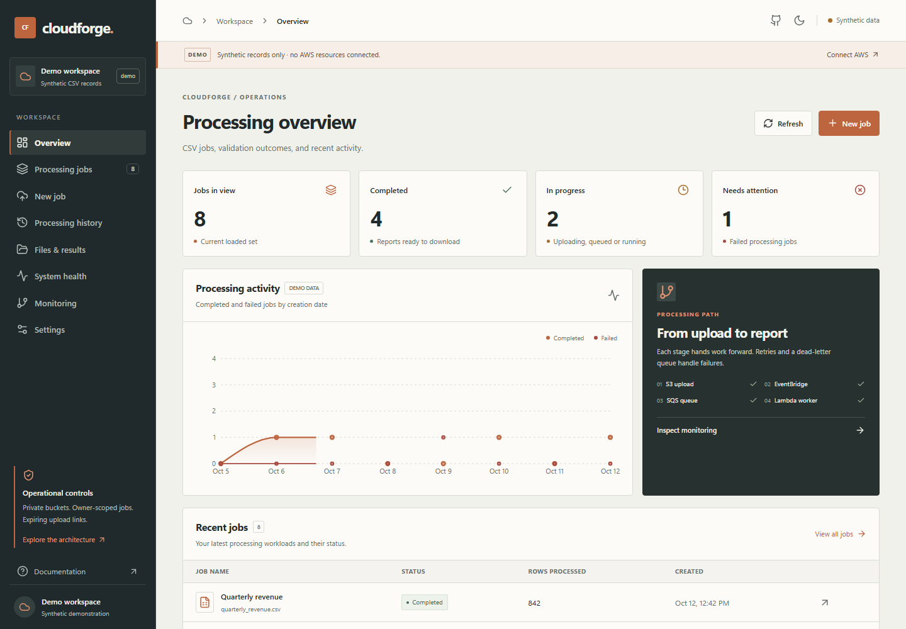
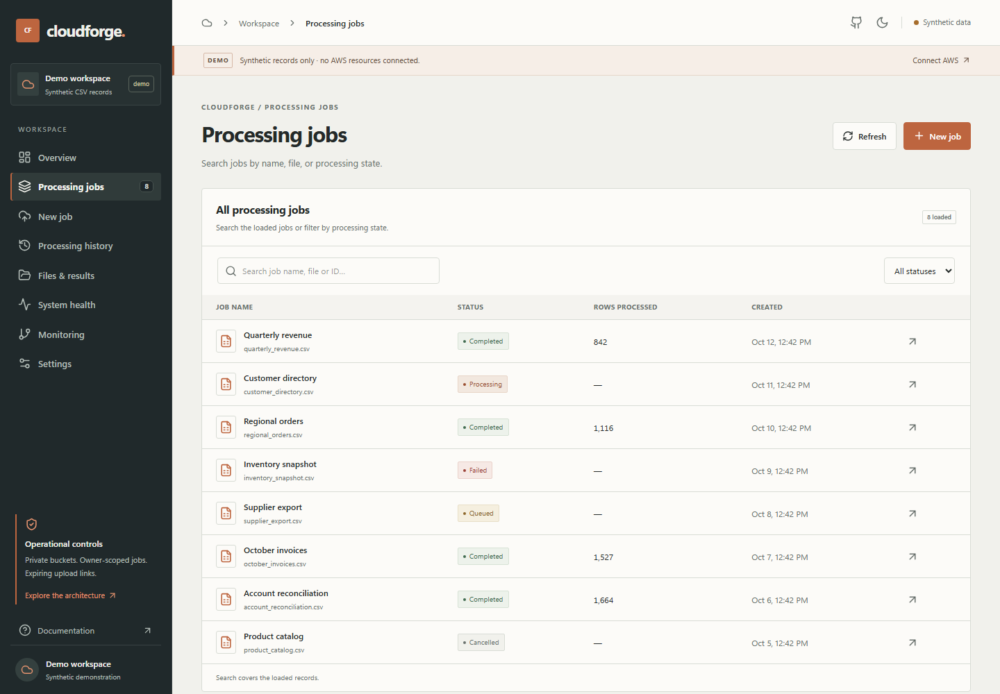
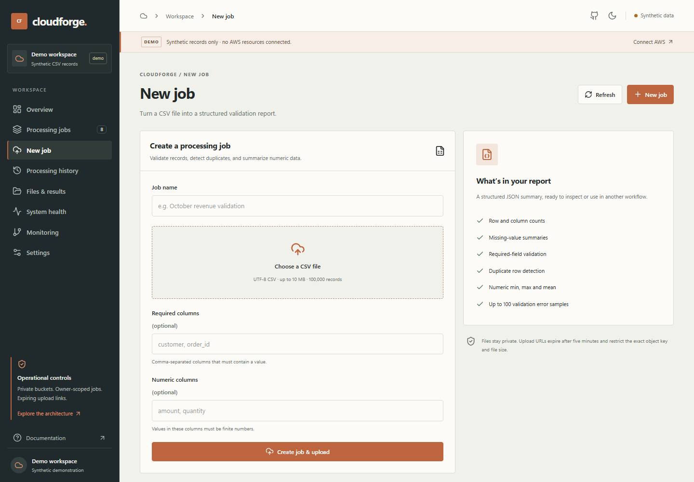

# CloudForge AWS

[](https://github.com/MDCran/cloudforge-aws/actions/workflows/ci.yml)

An event-driven CSV processing platform built with AWS serverless services. Upload files, follow asynchronous validation jobs, review bounded error summaries, and download JSON reports from a responsive operations dashboard.

## App screenshots

These captures show the main dashboard workflows in demo mode. Records and outcomes are synthetic; no AWS resources are connected.

### Overview



### Processing jobs



### New job



## Stack

- **Dashboard:** React, TypeScript, Vite, Tailwind CSS, and Recharts
- **API and processing:** Python 3.12, FastAPI, AWS Lambda
- **AWS services:** API Gateway, Cognito, S3, EventBridge, SQS, DynamoDB, CloudWatch, and SNS
- **Infrastructure and delivery:** Terraform, GitHub Actions, and short-lived AWS credentials through OIDC
- **Local development:** Docker Compose and Moto-backed AWS service emulation

## Getting started

Requirements: Docker, Node.js 22, and npm. The local API uses in-memory Moto services and local-only credentials. It does not need an AWS account or Cognito setup, and its data clears when the API stops.

From the repository root, start the local API and worker:

```powershell
docker compose up --build -d
```

In a second terminal, start the dashboard in local mode:

```powershell
Set-Location apps/web
npm ci
$env:VITE_MODE = 'local'
$env:VITE_API_URL = 'http://localhost:8000'
npm run dev
```

Open [http://127.0.0.1:5173](http://127.0.0.1:5173). To explore the dashboard without starting the API, run it in demo mode:

```powershell
$env:VITE_MODE = 'demo'
npm run dev
```

Demo mode uses synthetic records and simulated outcomes. Stop the local services from the repository root with `docker compose down`.

PowerShell helpers are available through `scripts/tasks.ps1` (`setup`, `test`, `lint`, `terraform-validate`, and `smoke-test`). Environments with GNU Make can use the equivalent targets in the `Makefile`.

## Configuration

Dashboard variables are documented in [`apps/web/.env.example`](apps/web/.env.example). The default mode is demo.

| Mode | Data and connection |
|---|---|
| `demo` | Synthetic records and simulated outcomes; no API or AWS connection. |
| `local` | Docker/Moto API, local uploads, queued processing, and report downloads. State resets when the API stops. |
| `aws` | Connects to a deployed API Gateway and Cognito environment. Configure the API URL, Cognito settings, and AWS region. |

The example file lists `VITE_API_URL`, `VITE_COGNITO_AUTHORITY`, `VITE_COGNITO_DOMAIN`, `VITE_COGNITO_CLIENT_ID`, `VITE_COGNITO_REDIRECT_URI`, `VITE_AWS_REGION`, and `VITE_ENVIRONMENT`. In AWS mode, Cognito tokens stay in browser session storage. The infrastructure has not been applied to a live AWS account from this repository.

## Routes

API routes require a Cognito access token except for `GET /health`.

| Method | Route | Purpose |
|---|---|---|
| `GET` | `/health` | Public service liveness check. |
| `POST` | `/v1/jobs` | Create an owner-scoped job with an idempotency key. |
| `GET` | `/v1/jobs` | List and filter jobs for the authenticated owner. |
| `GET` | `/v1/jobs/{jobId}` | Read an owned job and recent event history. |
| `POST` | `/v1/jobs/{jobId}/cancel` | Cancel a job before processing begins. |
| `POST` | `/v1/uploads/presign` | Create a short-lived, size-restricted upload policy. |
| `GET` | `/v1/jobs/{jobId}/result` | Get a short-lived report download URL after completion. |
| `GET` | `/v1/metrics/summary` | Read recent job and queue metrics; restricted to operators. |

Uploads are processed asynchronously through S3 events, EventBridge, SQS, and a worker Lambda. The worker checks required fields, duplicate rows, missing values, and numeric columns, then stores a report and bounded error sample. CSV uploads are limited to 10 MiB and 100,000 rows. See [Architecture](ARCHITECTURE.md) for the job lifecycle and API behavior.

## Local data and security

Demo data is synthetic. Local mode uses emulated AWS services and resets its state when the API stops. No live AWS telemetry or production data is included in the screenshot.

Private API routes use Cognito JWTs and owner-scoped job access. Upload and download links expire, file size and row count are bounded, and operations metrics are limited to the `operators` Cognito group. Pull-request checks run backend, dashboard, Terraform, dependency, and secret checks. Infrastructure deployment is a separate manual workflow using reviewed Terraform plans and per-environment OIDC roles.

## Verification status and limits

The API, worker, dashboard, Terraform checks, and test suites can be exercised without a live AWS account. The architecture has **not** been deployed from this repository, and no production availability or performance measurements are claimed. Review [known limitations](docs/security/known-limitations.md) and [scanner exceptions](docs/security/scanner-exceptions.md) for current project constraints.

## Learn more

- [Architecture](ARCHITECTURE.md) — services, data flow, and job lifecycle
- [Deployment](DEPLOYMENT.md) — bootstrap, environments, and infrastructure workflow
- [Security](SECURITY.md) — threat boundaries and security controls
- [Costs](COSTS.md) — cost assumptions and budget guidance
- [Operations](OPERATIONS.md) — metrics, alarms, and operational procedures
- [Troubleshooting](TROUBLESHOOTING.md) — local and deployment troubleshooting
- [Case study](CLOUD_CASE_STUDY.md) — project goals, tradeoffs, and implementation notes
