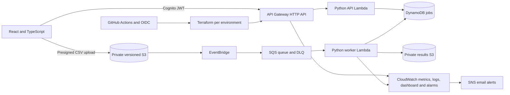

# CloudForge AWS

An event-driven CSV processing platform on AWS, built with Python, Terraform and React. Users submit files, monitor asynchronous validation jobs, inspect bounded error summaries and download JSON reports.


> The screenshot uses **synthetic demonstration data**. In demo and local modes, the interface labels synthetic or simulated data. It does not show deployed AWS telemetry.

[Architecture](ARCHITECTURE.md) · [Deployment](DEPLOYMENT.md) · [Security](SECURITY.md) · [Costs](COSTS.md) · [Operations](OPERATIONS.md) · [Troubleshooting](TROUBLESHOOTING.md) · [Case study](CLOUD_CASE_STUDY.md)

[](https://github.com/MDCran/cloudforge-aws/actions/workflows/ci.yml)

## Platform flow



## What it does

- Creates authenticated, owner-scoped jobs with idempotency keys, status filters and cursor pagination.
- Accepts private presigned uploads that restrict object key, file size, content type, encryption header and five-minute lifetime.
- Processes CSV data through S3 events, EventBridge, SQS and an independently permissioned Lambda worker.
- Reports row/column counts, missing values, required-field validation, duplicate rows and numeric min/max/mean. Invalid rows yield bounded error samples.
- Stores job history and attempt state. Conditional transitions, expiring worker leases, partial batch failures and a dead-letter queue protect the asynchronous lifecycle.
- Secures private API routes with Cognito JWTs and restricts operations metrics to the `operators` Cognito group.
- Tracks native service health and bounded CloudWatch operational metrics. Infrastructure CI uses short-lived OIDC roles and reviewed stored plans.
- Offers a responsive dashboard, file upload flow, job detail, history, result download, system monitoring, light/dark themes and an always-labelled synthetic demo mode.

## Local quick start

Requirements: Docker, Node 22 and npm. Local APIs use in-memory Moto services and fixed local-only credentials inside the simulator. Data clears when the API stops. No AWS account or authentication service is needed.

```powershell
docker compose up --build -d
Set-Location apps/web
npm ci
$env:VITE_MODE = 'local'
$env:VITE_API_URL = 'http://localhost:8000'
npm run dev
```

Open [http://127.0.0.1:5173](http://127.0.0.1:5173). For a no-server interactive tour, set `VITE_MODE=demo` and `npm run dev`; the header clearly identifies synthetic content. Stop the simulator with `docker compose down`.

On Windows, `scripts/tasks.ps1 setup`, `scripts/tasks.ps1 test`, `scripts/tasks.ps1 lint`, `scripts/tasks.ps1 terraform-validate`, and `scripts/tasks.ps1 smoke-test` provide PowerShell alternatives. `make setup`, `make test`, `make lint`, `make terraform-validate`, `make security` and `make smoke-test` are provided for environments with GNU Make.

## Job API

API routes are authenticated with Cognito except `GET /health`.

| Method | Path | Behavior |
|---|---|---|
| `GET` | `/health` | Public service liveness. |
| `POST` | `/v1/jobs` | Create an owner-scoped job; requires `Idempotency-Key`. |
| `GET` | `/v1/jobs?status=COMPLETED&limit=25` | List/filter jobs for the authenticated owner. |
| `GET` | `/v1/jobs/{jobId}` | Read an owned job and recent event history. |
| `POST` | `/v1/jobs/{jobId}/cancel` | Cancel before processing takes its lease. |
| `POST` | `/v1/uploads/presign` | Obtain a five-minute, size-restricted upload policy. |
| `GET` | `/v1/jobs/{jobId}/result` | Get a five-minute report download URL after completion. |
| `GET` | `/v1/metrics/summary` | Read recent owner-job counts and environment queue metrics; operators only. |

Create a job (the filename stays a plain basename):

```http
POST /v1/jobs
Authorization: Bearer <Cognito access token>
Idempotency-Key: monthly-orders-202610
Content-Type: application/json

{
  "name": "October order validation",
  "filename": "orders.csv",
  "size": 267,
  "required_columns": ["customer", "order_id"],
  "numeric_columns": ["amount"]
}
```

Send `POST /v1/uploads/presign` with `{"job_id":"<job UUID>"}`, then upload the unchanged CSV using the returned signed form fields. The API enforces exact declared object size. Poll `GET /v1/jobs/{jobId}` and retrieve a result only once the job state is `COMPLETED`.

To run the optional bounded smoke workflow, configure the local API and run `uv run python scripts/smoke.py`. A remote API requires an explicit `--live` flag and `CLOUDFORGE_ACCESS_TOKEN`; it creates one job and writes one upload/result object. The basic local test suite is credential-free.

## Dashboard modes

| `VITE_MODE` | Data and connection |
|---|---|
| `demo` | Synthetic sample records, simulated outcomes and downloadable synthetic reports. No API or AWS connection. |
| `local` | Docker/Moto API, CSV uploads, queued worker processing, DynamoDB-compatible state and real local report downloads. Data resets on server restart. |
| `aws` | API Gateway/Cognito environment configuration, signed S3 upload/download and deployed service health. Cognito credentials are stored only in session storage. |

See [`apps/web/.env.example`](apps/web/.env.example) and [Deployment](DEPLOYMENT.md) for real host and Cognito settings.

## Repository layout

```text
apps/api/                 HTTP API Lambda
apps/worker/              CSV processor and SQS worker Lambda
apps/web/                 React/TypeScript dashboard
packages/shared/          Validation, state model, configuration and DynamoDB repository
infrastructure/bootstrap/ Private S3 remote state, OIDC identities and optional budget alert
infrastructure/modules/   Small IAM, S3, DynamoDB, SQS, Lambda, API, Cognito and observability modules
infrastructure/environments/ Independent dev, staging and prod roots
scripts/                  Local simulator, deterministic Lambda packager and smoke runner
tests/unit/               CSV/report and request validation tests
tests/integration/        Moto persistence, auth, event and worker lifecycle tests
tests/e2e/                Complete in-memory upload-to-report workflow
tests/infrastructure/     Terraform security, permissions and state contract checks
```

## CI, security and costs

Pull requests run backend lint, types, coverage, dashboard checks, Terraform validation, mocked-provider tests and high/critical dependency/secret scanning. Terraform formats and security scans have no AWS credentials. `terraform` deployment is separate, manual, tied to a protected main ref, and uses per-environment OIDC roles and encrypted short-lived saved plans. Drift detection is a read-only weekly dev plan after credentials have been configured.

This serverless design avoids provisioned baseline compute, but AWS services are not universally free. Lambda concurrency, API throttling, 10 MiB uploads, 100,000 rows, file/log lifecycles and SQS retention have explicit bounds. Optional budget alerts do not cap spending. Consult [Costs](COSTS.md).

## Verification status and limitations

The API, worker, CSV processor, local HTTP simulator, dashboard demo and integration tests run without a live AWS account. Terraform formatting, module validation, environment isolation, static Checkov controls and mocked-provider S3/SQS plan checks run locally/CI. GitHub records current workflow results. The AWS architecture has **not** been applied to a live account from this repository. The included dashboard screenshot is synthetic. No performance/availability measurements or certification are claimed. Review [scanner exceptions](docs/security/scanner-exceptions.md) and [known limits](docs/security/known-limitations.md).
